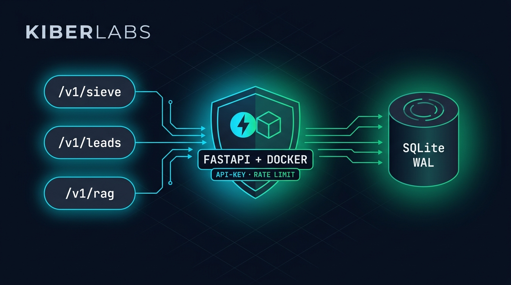
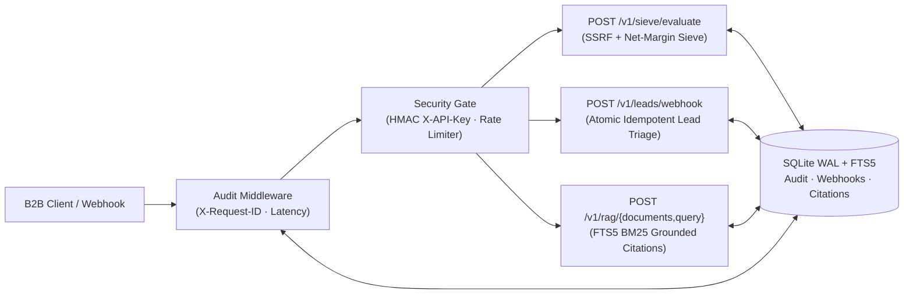

# KiberLabs — Production B2B Automation API Gateway (FastAPI + Docker)

[](https://github.com/Kiberlabs/kiberlabs-automation-api/actions/workflows/ci.yml)



A production-ready **FastAPI + Docker B2B automation gateway** uniting KiberLabs' deterministic Python engines behind **constant-time API-Key authentication**, **sliding-window rate limiting**, **SSRF validation**, **atomic webhook idempotency**, and **concurrent SQLite (`WAL` + `FTS5`)** persistence.

Built as a reusable deployment accelerator so B2B teams can go from specification to a hardened, containerized REST service with live OpenAPI/Swagger (`/docs`) in days instead of weeks.

---

## Architecture



## Key Engineering Highlights

- **Constant-Time Auth & Rate Limiting:** Protects all `/v1/*` routes via `hmac.compare_digest` on `X-API-Key` and per-key sliding-window rate limits (`429 Too Many Requests` + `Retry-After` + `X-RateLimit-Remaining`).
- **Multi-Stage Non-Root Docker Build:** Slim Python 3.11 container running as unprivileged `appuser` with built-in HTTP `/health` liveness check.
- **SQLite WAL + FTS5 Core:** Zero external database setup needed for SMEs; enforces `PRAGMA journal_mode=WAL`, `busy_timeout=5000`, atomic `(channel, message_id)` deduplication, and accent-insensitive BM25 search.
- **Full Automated Integration Suite:** Verified end-to-end with FastAPI `TestClient` + `pytest` across auth (`401`), rate limiting (`429`), SSRF (`422`), webhook retries, and RAG zero-hallucination abstention.

---

## Quickstart

```bash
# 1. Install dependencies & run automated integration tests
pip install -e ".[dev]"
pytest -v

# 2. Run locally with Uvicorn (Swagger UI at http://127.0.0.1:8000/docs)
KIBERLABS_API_KEYS=kl-dev-demo-key uvicorn kiberlabs_api.app:app --reload

# 3. Or build & run in Docker
docker build -t kiberlabs-automation-api .
docker run -p 8000:8000 -e KIBERLABS_API_KEYS=your-secret-key kiberlabs-automation-api
```

---

## API Endpoints

| Method & Path | Auth | Description |
| :--- | :--- | :--- |
| `GET /health` | Public | Liveness probe & active SQLite WAL check |
| `POST /v1/sieve/evaluate` | `X-API-Key` | Batch SKU net-margin sieve with SSRF URL boundary guard |
| `POST /v1/leads/webhook` | `X-API-Key` | Idempotent WhatsApp/Telegram/Web lead qualification webhook |
| `POST /v1/rag/documents` | `X-API-Key` | Article/section-aware document indexing into SQLite FTS5 |
| `POST /v1/rag/query` | `X-API-Key` | BM25 grounded citation retrieval with `INSUFFICIENT_EVIDENCE` gate |
| `GET /v1/audit/recent` | `X-API-Key` | Recent HTTP request telemetry (`request_id`, status, latency) |

---

## License

MIT — Built by **KiberLabs Engineering** (*AI & Python Automation Studio*).
